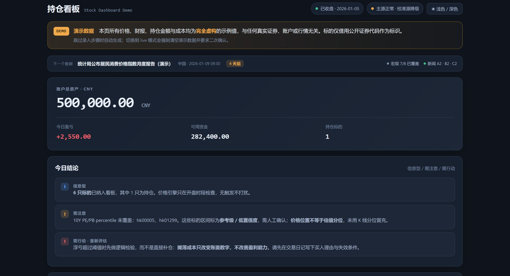
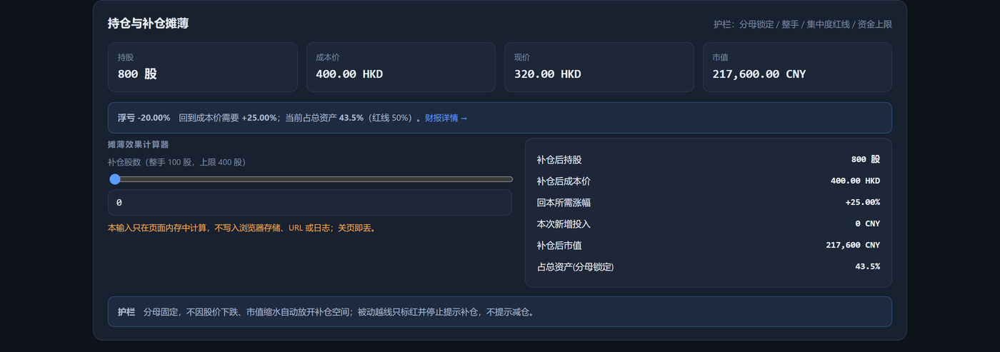
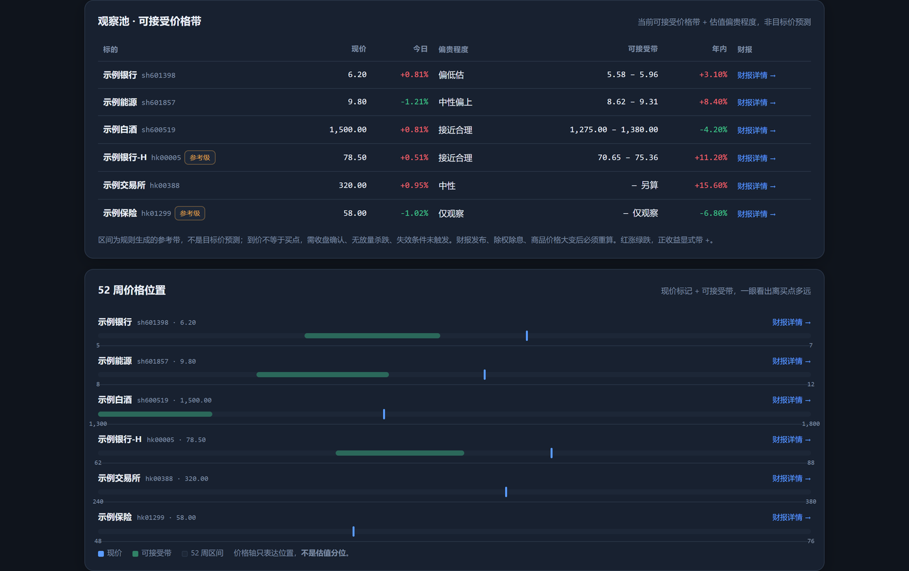
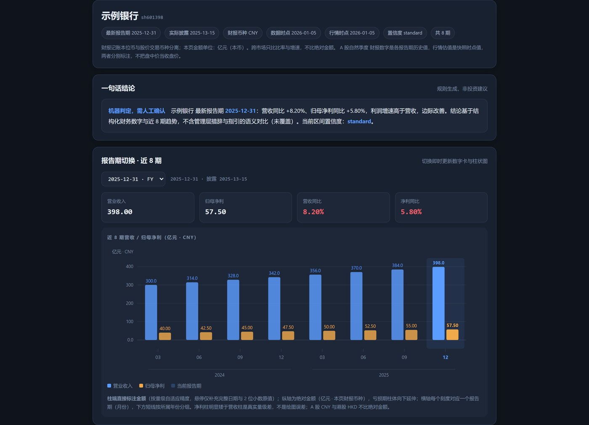
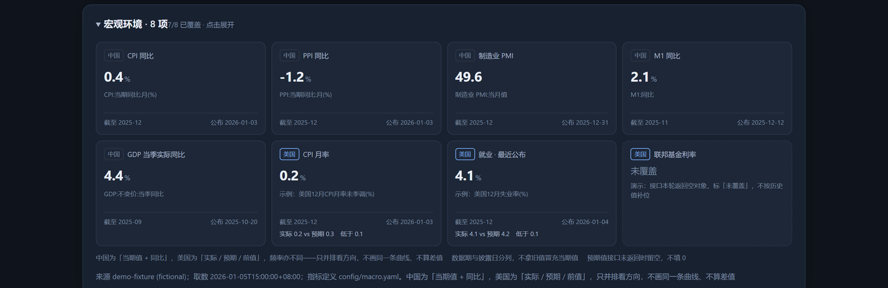
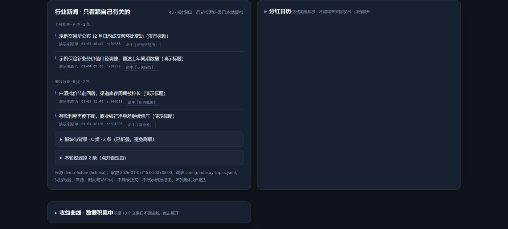
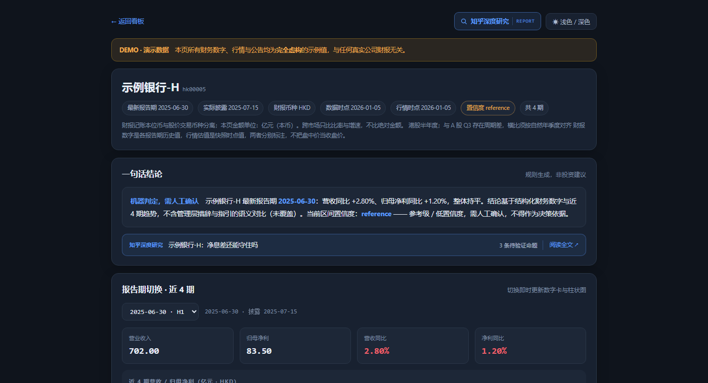
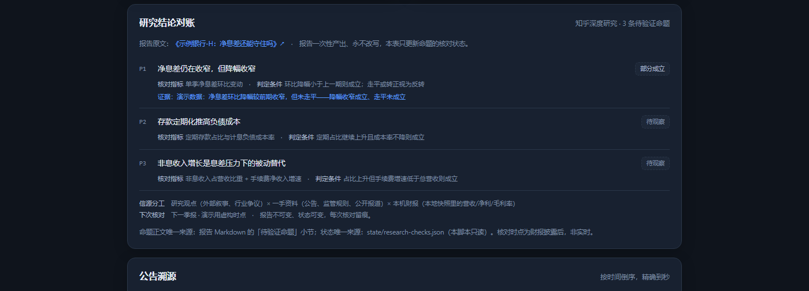

# ginado-stock-dashboard-skill

股票看板 Skill。给 Agent 用，产出是本地静态 HTML，断网能打开，不上传到任何服务器。

[](LICENSE)

---

## 主要功能

1. 自动监控自选标的的价格走势，进入合适区间则通过企业微信通知
2. 给出持仓股票的补仓建议，当补仓价格合理时，主动通知
3. 补仓时可以记录补仓原因，方便复盘
4. 监控所有自选标的的财报，可查看详细的财报分析
5. 自动监控中美两国重要宏观环境指标数据
6. 定时更新自选标的所在行业的重要新闻
7. 通过知乎CLI，给出标的深度研究报告

## 界面

首页



持仓与补仓摊薄



观察池价格带与 52 周价格位置



财报详情页



宏观环境



行业新闻



知乎深度研究



命题逐条对账，报告永不被改写



以上截图全部取自 `example/` 的 demo 实例，数据是虚构的。

## 说明

需要添加 Wind、腾讯自选股、企业微信的连接器。

- **腾讯自选股**：行情、财报、公告、分红、宏观指标、24 小时快讯。主源
- **Wind**：估值历史分位，PE、PB、股息率。缺了不影响出看板，但分位降级为参考级，会标「低置信度、需人工确认」
- **企业微信**：财报速递、到价提醒、宏观和新闻汇总的推送通道

规则和脚本里没有写死供应商名字，只区分「主源」「校准源」「推送通道」，换成别家的连接器也能用。

## 先看效果，不用装任何东西

下载仓库后直接双击 `example/dashboard/index.html`。

里面是 6 只演示股票的完整成品，价格、财报、持仓金额全是编的，股票代码本身是公开的（工行、中行、茅台等），跟真实行情无关。页面顶部常驻一条「演示数据」横幅，防止和真实数据搞混。

`example/dashboard/stocks/` 下还有 6 个财报详情页，从首页的「财报详情」点进去。其中 `hk00005` 那条带了一份**虚构的深度研究示例**：顶栏有「知乎深度研究」按钮，首屏有入口条，页面靠下有「研究结论对账」卡片，点进去是 `example/reports/2026-01/2026-01-08-research-hk00005.html`——报告长什么样、命题怎么挂指标，那里看得最清楚。

`example/` 镜像的是一个**实例根目录**的样子（`dashboard/` + `reports/`），所以跨目录链接直接点得通。

## 自己跑一遍

只要 Python 3.9 以上，无第三方依赖，不需要网络：

```bash
git clone https://github.com/ginadochen/ginado-stock-dashboard-skill.git
cd ginado-stock-dashboard-skill

python scripts/instance.py        --root ../my-demo --mode demo
python scripts/build_dashboard.py --root ../my-demo
python scripts/build_stock_pages.py --root ../my-demo
```

然后打开 `../my-demo/dashboard/index.html`。

`--root` 是产物目录，必须在仓库外面，脚本会拒绝往仓库里写东西。想清理就整个删掉。

## 作为 Skill 用

把整个目录放进 WorkBuddy 或 CodeBuddy 的 skills 目录，然后对 Agent 说「帮我做一个股票看板」。

Agent 会按 `SKILL.md` 的 8 步走：定目录、录标的和持仓、选模式、取数、构建、后续变更、配定时任务、自检。

你的数据有三种进来的方式：

- **跳过**，先用内置虚构数据看样式，之后再换真的
- **手动填**，照 `assets/templates/portfolio.yaml.example` 填持仓和成本
- **传持仓截图**，只截持仓表格区域，先把账户名、资金账号、身份证号、手机号挡住。截图本身还是含金额和成本，只在当次会话里解析，结果写进你本地的 `config/`，原图不入库不进日志。没把握就手填

两种模式：`demo` 用内置虚构快照，断网可跑；`live` 用真实持仓和实时行情，需要上面三个连接器。切到 `live` 时会强制清空演示数据，避免两套数字混在一起。

## 定时任务

一共 6 条，只在开盘时段跑，节假日自动静默退出：

| 时间 | 做什么 |
|---|---|
| 09:30 | 财报监控；周一全量取宏观，其余日子查日历 |
| 10:00 | 价格检查 + 行业新闻 |
| 11:00 | 价格检查 |
| 14:00 | 价格检查 + 行业新闻 |
| 15:00 | 价格检查 |
| 16:00 | 收盘汇总，净值埋点，除权检测 |

价格告警按触发推，同一个档位只推一次。宏观和新闻这类信息性内容合并成一条，一天最多一条。没触发就不说话。

## 它不做什么

- 不提供投资建议，不执行交易，不代下单
- 不把看板发到公网，不默认创建定时任务，不默认写平台的到价提醒
- 不打包、不二次分发任何供应商的行情和财报数据

## 隐私和安全

- `.gitignore` 首行是 `*`，默认拒绝，只放行白名单，新文件不会意外进仓库
- `privacy_check.py` 扫金额、姓名、聊天 ID、绝对路径、token、邮箱手机 IP、私钥头
- 持仓和成本只写本地 `config/`，不进日志、不进通知、不进仓库
- 发布前做过独立 clone 复扫，记录在 [docs/PRIVACY-AUDIT.md](docs/PRIVACY-AUDIT.md)

## 关于数据合规

`live` 模式要自备连接器。本项目不打包、不转售任何供应商数据，部分供应商条款禁止第三方工具提取或对外展示，启用前请自行确认。`demo` 模式不涉及。

## 想改代码

```
scripts/
  instance.py          从模板生成一个新实例（demo / live）
  build_dashboard.py   读本地快照，生成首页
  build_stock_pages.py 生成每只股票的财报详情页
  check_sources.py     探测数据源是否可达，不可用就降级
  macro_release_due.py 判断今天有没有宏观数据发布，有就只重取那几项
  record_nav.py        每日净值埋点
  privacy_check.py     隐私扫描
  layout_check.py      检查产物有没有写到不该写的地方
references/            口径、方法论、调度规则、实测踩坑、免责声明
assets/templates/      agent.md 模板 + 9 份 *.yaml.example
assets/demo/           7 份虚构快照
docs/                  隐私验收记录 + CI 模板
```

值得一读的是 [`references/pitfalls.md`](references/pitfalls.md)，33 条实测踩过的坑。比如数据源显示「已连接」但上游整个域名不可达、公告接口是语义检索会串到别家公司、宏观接口传时间范围会返回几百万字符把上下文撑爆、定时任务时区算错落到半夜。

## 免责声明

个人持仓整理和信息可视化工具，不提供投资顾问服务。所有价位、区间、分位和结论都是基于公开数据的量化参考，不构成投资建议。市场有风险，投资需谨慎。完整文本见 [`references/disclaimer.md`](references/disclaimer.md)。

## License

Apache-2.0 © 2026 ginadochen，见 [LICENSE](LICENSE) 与 [NOTICE](NOTICE)。
